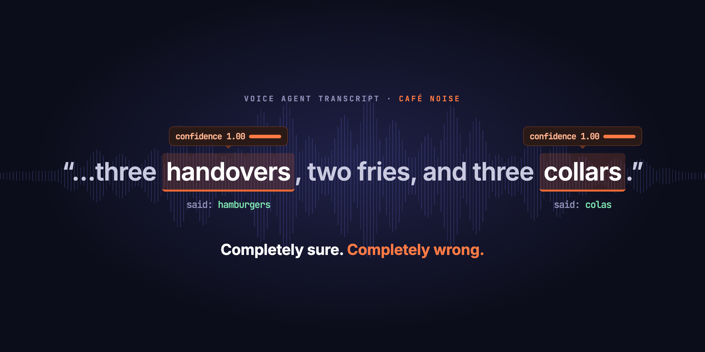
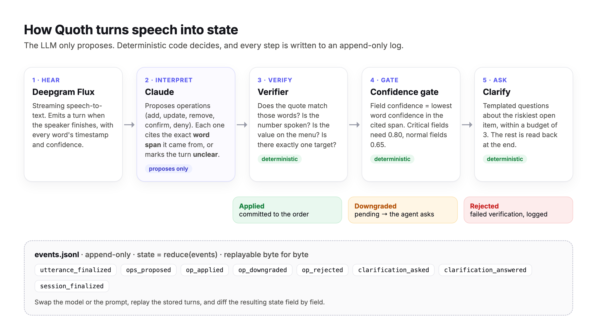
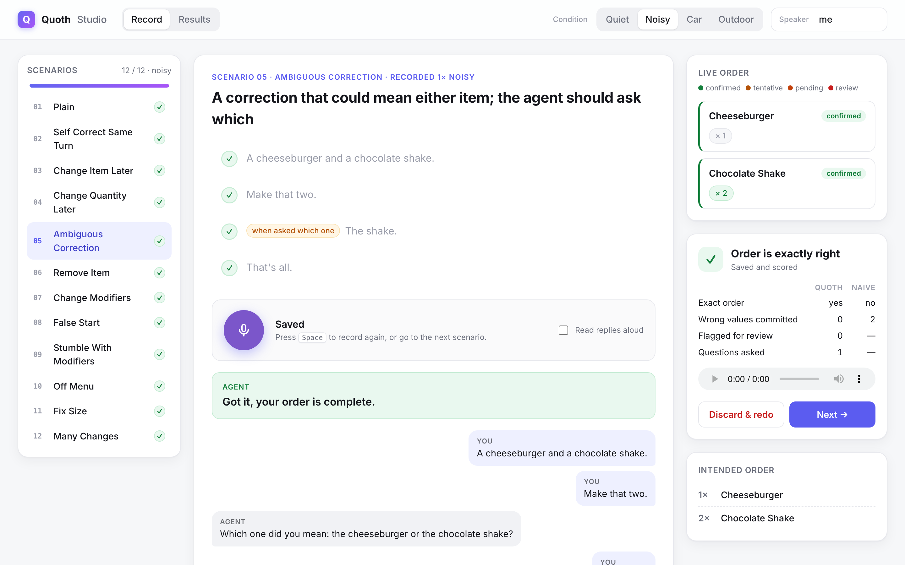
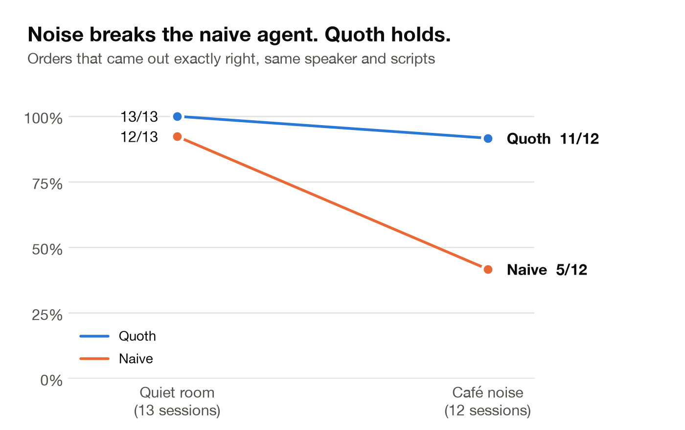
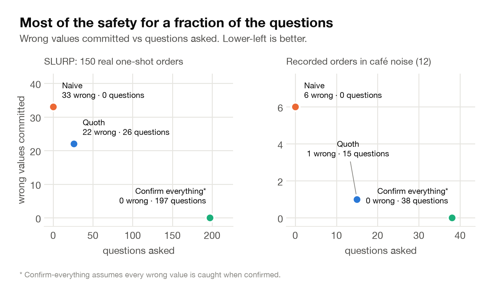
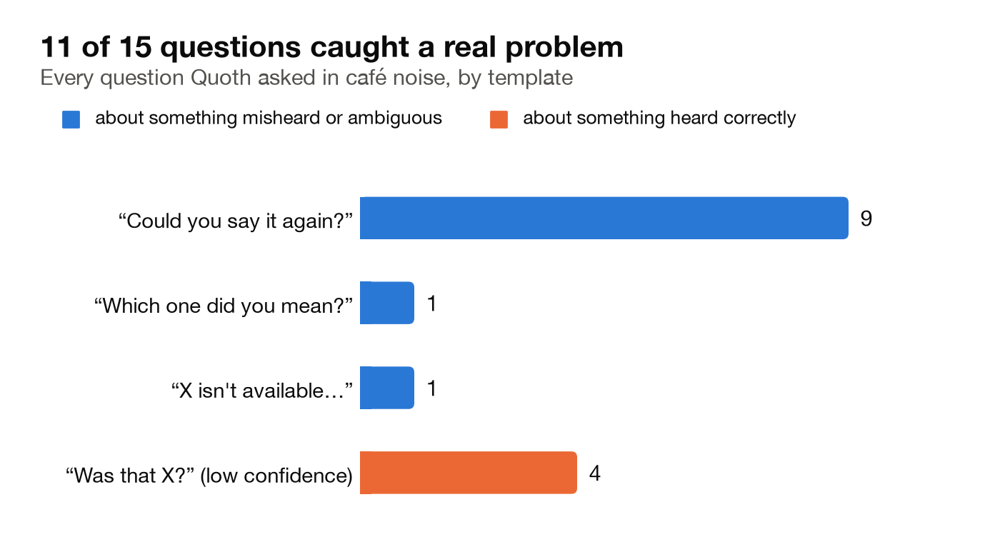
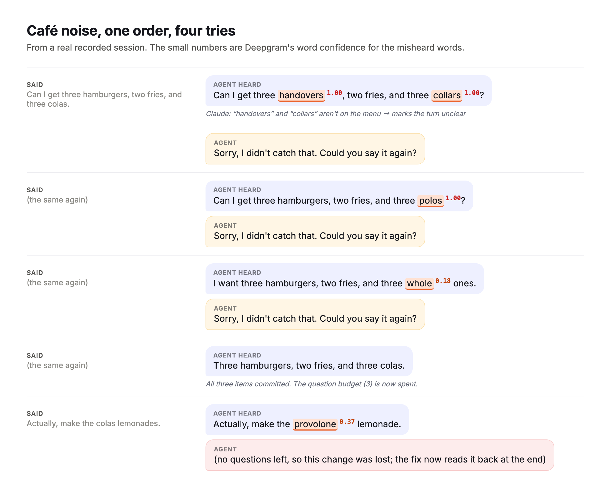
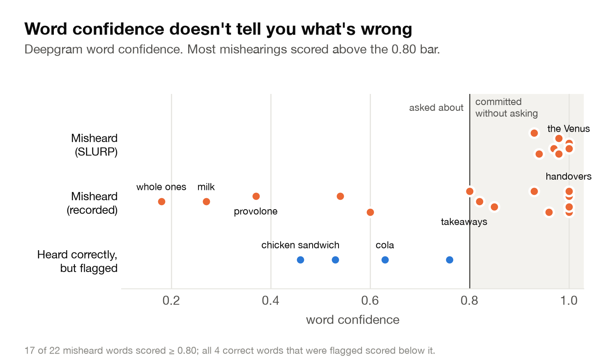

# “Make That Two.” Which One?

## What I learned building a voice agent that knows what it heard, and asks only when it should



You're at a drive-thru. You order a cheeseburger and a chocolate shake, then add: *“Make that two.”*

A person behind the counter would hesitate. Two burgers? Two shakes? Two of everything? Most voice agents don't hesitate. They pick one and carry on, and you find out at the window.

Wrong guesses aren't the only problem. Voice agents mishear things, and when they do, nothing in a typical pipeline notices. The speech recognizer turns audio into text, an LLM turns text into actions, and every handoff throws away the information about *how sure anyone was*. By the time the order reaches the kitchen, a misheard word and a clearly spoken one look exactly the same.

I built a small open-source engine called **Quoth** to test one idea: a voice agent should know what it heard, know how sure it is, and spend its questions where they matter. Then I tested it on real speech, including my own voice in a noisy café. The results surprised me, and one of the surprises changed what I think the engine is for.

## The trade-off every voice agent makes

A voice agent can fail in two ways.

**It can be silently wrong.** A misheard “fifteen” becomes 50, or the shake becomes a second burger. Nobody finds out until the food arrives. This is the expensive failure.

**It can be annoying.** “Did you say cheeseburger? Did you say one? Did you say chocolate shake?” Each question costs a little patience. A question at least can't corrupt the order.

The two simple strategies sit at opposite ends. A **naive** agent trusts whatever the LLM extracts and never asks: no friction, all the risk. A **confirm-everything** agent reads every item back: close to no risk, but tedious. The goal is the middle: *most of the safety of confirming everything, for a small fraction of the questions.*

## How Quoth works


*The LLM proposes. Deterministic code decides. Every step is logged.*

Quoth sits between a speech recognizer and the rest of the agent. I used **Deepgram Flux** for streaming speech-to-text and **Claude** to interpret each turn. The design rests on four rules.

**1. The LLM only proposes.** Claude never edits the order directly. It returns *operations* (add, update, remove, confirm, deny), and each one must cite the exact words it came from:

```json
{
  "op": "add",
  "field": "quantity",
  "value": 2,
  "word_span": [0, 2],
  "quote": "Make that two.",
  "is_correction": true,
  "correction_target_candidates": ["line_1", "line_2"]
}
```

That's a real operation from one of my recordings. Claude didn't guess which item “that” meant; it listed both candidates.

**2. Deterministic code checks the proposal.** A verifier checks the quote against the words at that position, that any number was actually spoken, that the value is on the menu, and that a correction has exactly one target. Here there were two targets, so the operation was held back as *pending* and the agent asked: *“Which one did you mean: the cheeseburger or the chocolate shake?”*

**3. Speech confidence survives the LLM.** This is the core idea. Deepgram gives every word a confidence score, and LLMs normally never see it. Because each operation cites its word span, Quoth can look up the confidence of exactly the words behind each value. A critical field like the item or the quantity needs 0.80 to be committed without asking; anything lower becomes a question. Asking is a budgeted resource: at most three questions per conversation, and anything still unresolved is read back at the end.

**4. Everything is an event.** Every utterance, proposal, decision, and question is appended to a log, and the current order is just a replay of that log. That makes every session auditable and lets you re-run an old conversation through a new prompt or model and see exactly which values change. As it turned out, that was the most useful property of all.

## Test 1: real people, one sentence each

I started with **SLURP**, a public research dataset of people speaking commands, using its 75 takeaway-ordering sentences, each recorded twice: once on a headset and once on a distant microphone. That's 150 recordings of real voices.

Compared with the naive strategy, Quoth committed a third fewer wrong values (33 → 22) while asking 26 questions. Confirming everything would have taken 197. That's the right direction, but not a decisive result.

The most interesting part was *what* got through. Restaurant names were misheard badly: “Deliveroo” became *“the liverwhip”*, “Domino's” became *“the Venus”*, “Jason's Deli” became *“Jason's daddy”*. And Deepgram reported those words at **0.93 to 1.00 confidence**. The recognizer wasn't unsure. It was confidently wrong.

Keep that in mind; it comes back.

## Test 2: my own voice, scripted orders, quiet vs noisy

SLURP sentences are single commands, so they can't test what Quoth was really built for: corrections, changes of mind, and the clarifying questions. So I wrote 12 short ordering scripts, each with a specific trap:

- Correcting yourself mid-sentence: *“Two, uh, actually three chicken sandwiches.”*
- Changing your mind a turn later: *“Make the hamburger a veggie burger.”*
- A false start: *“A vanilla, no, strawberry shake.”*
- Removing an item, taking back a modifier, fixing a size.
- Ordering something that isn't on the menu.
- The ambiguous *“Make that two.”*

I recorded all 12 in a quiet room, then again with a café-ambience track (background chatter and clattering dishes) playing from my phone a metre or two away.


*A small local web app runs each scripted session live and scores it the moment it ends.*

Each session is scored against the order I actually meant to place. As a fair comparison, the naive baseline is computed from the same sessions: the LLM's proposals applied directly, with no checks and no questions. One detail matters here, and I got it wrong at first. Quoth's questions make the speaker say things they wouldn't otherwise say, such as repeating an order. A naive agent never asks, so those answers would never exist. If the naive score includes them, naive gets credit for corrections that Quoth's questions drew out. The final scoring drops those turns from the naive baseline, but keeps lines the speaker would have said anyway.


*Same speaker, same scripts. Noise barely touches Quoth and wrecks the naive agent.*

In a quiet room, both approaches did well: Quoth got 13 of 13 orders exactly right, naive 12 of 13. Naive's one miss was the ambiguous *“make that two”*: it gave the 2 to the burger.

In café noise, naive fell to **5 of 12**. Quoth got **11 of 12**.

The cost was questions: 2 in the whole quiet set, 15 across the 12 noisy sessions, so a little over one per order. That's the behaviour you want. The agent stays out of the way when the audio is clean and starts checking when it isn't.


*Lower-left is better. In noise, Quoth gets close to confirm-everything's safety with fewer than half its questions.*

## The surprise: confidence isn't what caught the errors

Going in, I assumed the confidence gate would do most of the work: low-confidence words get questioned, high-confidence words go through. So I went through all 15 questions from the noisy set and checked each one by hand.



Eleven of the 15 questions (73%) were about something genuinely misheard or ambiguous, compared with 42% on SLURP. But look at *which* questions those were.

The four questions triggered by **low word confidence** were all about words that had been heard *correctly*. “Was that chicken sandwich?” Yes, it was.

The questions that caught real errors were mostly *“Sorry, I didn't catch that. Could you say it again?”* That question isn't triggered by confidence at all. It fires when Claude looks at a turn and says, in effect, “this doesn't make sense for this menu and this order.”


*From a real noisy session. The recognizer was certain about “handovers”, “collars” and “polos”.*

In noise, Deepgram heard *“three hamburgers… and three colas”* as **“three handovers… and three collars”**, both at confidence **1.00**. On the next try, the colas became **“polos”**, also at 1.00. *“I do want pickles”* became **“I do want takeaways.”** No confidence threshold could catch these, because the recognizer wasn't uncertain. It produced real, confident English words that happened to be wrong.

What catches them is meaning. “Handovers” isn't on a burger menu, and “make the provolone lemonade” isn't a coherent change to an order of burgers, fries and colas.


*Across both tests, 17 of 22 misheard words scored at or above the 0.80 bar.*

That's the finding I'd most want another builder to take away. **Word confidence is a weak signal of error. A fixed vocabulary plus “does this make sense?” is a strong one.** The confidence gate still earns its place as a cheap backstop, but it isn't the main defence I expected.

## Three failures, found and fixed

Evaluation also found three real failures, and they make good case studies.

**1. The silent drop.** In my first quiet-room recording, Deepgram heard *“make the colas lemonades”* as *“make Tacolas lemonades.”* Claude noticed. Its notes for that turn literally say *“Recommend clarifying.”* But Claude had no way to ask, so it proposed nothing, and the correction vanished.

Every check in the pipeline examined the operations Claude *proposed*. A turn that produced no operations passed all of them by definition. **Validators can only check what they're given; they can't see what was left out.** That gap exists in almost any LLM pipeline with a validator after the model.

The fix was small: Claude can now mark a turn `unclear`, and the agent asks the person to repeat it. I checked it without re-recording, by replaying the stored turns through the new prompt. The agent asked at exactly the misheard turn, and no other turn across 13 sessions was wrongly flagged. In the noisy set, that question fired 9 times, and every time the transcript really was garbled.

**2. The nonsense question.** When I ordered a pepperoni pizza, the agent asked *“Onion rings or strawberry shake?”* It offered the two closest-sounding menu items even when nothing on the menu was close. Real mishearings scored 0.75 or higher on a string-and-sound similarity measure (for example, “valuable shake” against vanilla shake). Real off-menu items scored 0.45 or lower. Below 0.5, the agent now says *“Sorry, pepperoni pizza isn't available. What would you like instead?”*

**3. The empty budget.** In one noisy session, three garbled attempts at the same order used all three questions. The next garbled turn, *“make the provolone lemonade”*, had nothing left to spend, so the colas were committed and the readback never mentioned it. Now any turn the agent couldn't understand and didn't get to ask about is read back at the end: *“Please double-check: … which I didn't catch.”* Running out of questions still costs something, but it's no longer silent.

All three fixes came out of the same loop: record, score, read the event log, find the exact turn, change one thing, replay. Being able to replay sessions is what made each fix quick to verify.

## What this does and doesn't show

Some honest limits:

- **Small sample.** One speaker (me), reading scripts I wrote, 25 recorded sessions plus 150 SLURP clips. A gap of a few orders is suggestive, not proof.
- **A cautious baseline.** The naive baseline uses the same careful prompt as Quoth, minus the questions. An LLM told to guess would sometimes guess right; “handovers” probably means hamburgers.
- **Untested conditions.** I haven't tested other voices and accents, or the nastiest kind of noise: a single competing voice, such as a TV, whose words the recognizer might attribute to you.

None of the individual ideas is new. Confirming only when unsure goes back decades in spoken-dialogue research; event logs are ordinary software engineering; making an LLM cite its sources is a known technique. What I think is useful is the combination, and the evidence for where the safety actually comes from.

## Takeaways for anyone building a voice agent

1. **Don't let the LLM's output be the state.** Let it propose; let code decide. Your validator then has something concrete to check.
2. **Make the LLM point at the words it used.** That one rule lets speech confidence follow each value through the pipeline, and makes made-up values easy to reject.
3. **Give the model a way to say “I don't know.”** If the only output is actions, confusion becomes silence, and silence passes every check.
4. **Constrain the vocabulary wherever you can.** A menu, a product catalogue, a list of account types. Confidently misheard words are common; confidently misheard words that also match your vocabulary are rare.
5. **Budget the questions.** Users tolerate about one clarifying question per task. Spend them on what's critical and ambiguous, and read back whatever is left.
6. **Log everything as events, then replay.** That's how you find bugs like “Tacolas” and prove a fix works without recording anything new.

The code, the 12 scenarios, the recording studio, and both evaluations are open source: **[github.com/UniqueRed/quoth](https://github.com/UniqueRed/quoth)**.

*Built with Deepgram Flux for streaming speech recognition and Claude for interpretation. SLURP audio is licensed CC BY-NC 4.0.*
